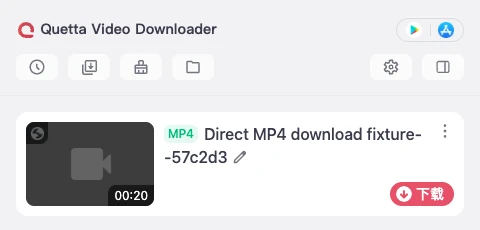
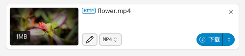
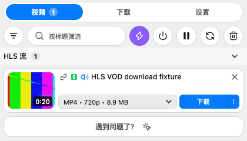
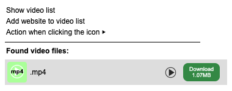
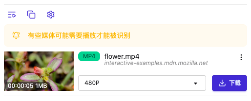
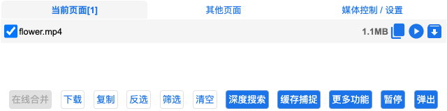

# 6 款 Chrome 网页视频下载插件对比（2026）

**简体中文** · [English](docs/README.en.md) · [Español](docs/README.es.md) · [Português (Brasil)](docs/README.pt-BR.md) · [日本語](docs/README.ja.md)

本文对比 **Quetta 视频下载器、Video Download Helper、MAX Video Downloader、Video Downloader Professional、FetchV 和猫抓**的收费方式、下载前预览、MP4 和 M3U8/HLS 支持，以及适用的网页场景。

资料核对于 **2026 年 11 月 24 日** · [实测方法与结果](docs/testing.md) · [官方资料与截图出处](docs/sources.md)

[快速选择](#快速选择) · [六款插件](#六款视频下载插件) · [网站与视频场景](#网站与视频场景) · [常见问题](#常见问题)

## 快速选择

- **下载前预览和选画质** → Quetta 提供免费、免登录的操作流程。FetchV 和猫抓也提供媒体预览。
- **需要处理流媒体和音轨** → FetchV 适合处理 HLS 点播和直播。MAX 适合查看流、音轨和字幕。Video Download Helper 还提供格式转换和音频提取。
- **主要保存直链 MP4** → Quetta 或 Link64 的 Video Downloader Professional。后者的待看列表适合先收集再播放。
- **想看网页具体加载了哪些资源** → 猫抓。其开源项目提供资源捕获、预览和播放清单解析。

## 六款视频下载插件

以下截图来自 Chrome 扩展界面。图注标明各面板显示的状态，文件保存结果见[实测记录](docs/testing.md)。

### Quetta 视频下载器

Quetta 的 Chrome 扩展免费、免登录，可以识别页面中兼容的 MP4、WebM、HLS（M3U8）和 MPEG-DASH。面板内提供缩略图和视频预览，页面有多档源时可选清晰度。对同页有正片、短片和多个清晰度的场景，先看一眼再保存可以少下错文件。Chrome 版不支持 YouTube 下载。官方说明也将 DRM 或付费墙保护的媒体列为限制。[Chrome 扩展](https://chromewebstore.google.com/detail/quetta-video-downloader/cblecgnkfldiipmmfpiolmfhfphhfngo) · [官方使用说明](https://www.quetta.net/solutions/how-to-download-videos-with-quetta-video-downloader)

*本地 MP4 已被识别，面板显示预览区和下载按钮。*

**实测。** Chrome 版两次保存约 9.4 MB 的本地 MP4，其中一份通过源文件校验。面板显示了预览区域，样片的预览播放与 HLS 文件保存仍待验证。[实测方法与结果](docs/testing.md)

### Video Download Helper

经常处理 HLS、DASH，或者需要转成 MP4、MKV、WebM、提取 MP3 时值得考虑。发布者提供 Chrome、Firefox 和 Edge 入口，核心功能免费，高级方案增加无限下载、字幕等功能。Chrome 版排除 YouTube。安装前可按浏览器版本和实际任务查看免费额度及功能说明。[官方网站](https://downloadhelper.net/) · [Chrome 扩展](https://chromewebstore.google.com/detail/video-download-helper/lmjnegcaeklhafolokijcfjliaokphfk) · [高级方案](https://downloadhelper.net/premium)

*面板显示 MDN 样片的缩略图，可查看 MP4 格式选项。*

### MAX Video Downloader

免费且免登录，官方列出的格式包括 HLS、DASH、MP4 和 WebM。它提供媒体预览缩略图、音轨、字幕和本地合并工具，复杂任务可选用桌面辅助应用。需要辨认多条流或分离音轨时，MAX 提供的选项更细。Chrome 商店说明排除 YouTube 和 DRM 内容。[Chrome 扩展](https://chromewebstore.google.com/detail/max-video-downloader-%E2%80%93-do/kjinbaahkmjgkkedfdgpkkelehofieke) · [官方功能说明](https://maxvideodownloader.pro/architecture)

*视频列表识别到本地 HLS 样片，并显示缩略图和 720p MP4 选项。*

### Video Downloader Professional

本文评测的是 **Link64 GmbH** 发布的 Chrome 版。其免费安装页面介绍了视频保存、可用清晰度选择、已识别 MP4 的投屏和待看列表。适合日常找直链视频。官方说明对 HLS 和 DASH 的覆盖未给出明确承诺，并列出了 YouTube、Instagram、Dailymotion、VK 和 TikTok 的下载限制。[Chrome 扩展](https://chromewebstore.google.com/detail/video-downloader-professi/elicpjhcidhpjomhibiffojpinpmmpil)

*Link64 版列出了 MDN 的 MP4 样片，并显示文件大小和下载按钮。*

### FetchV - M3U8/HLS 视频下载器

FetchV 免费、免登录，提供 Chrome 和 Edge 入口。官方介绍了 HLS 点播和直播、DASH 点播、MP4 和 WebM，以及检测后的媒体预览。它可以将受支持的 HLS 片段合并为 MP4。流的编码和分段方式会影响能否完整保存。Chrome 版排除 YouTube 和 DRM 内容。[官方网站](https://fetchv.net/) · [Chrome 扩展](https://chromewebstore.google.com/detail/fetchv-video-downloader-f/nfmmmhanepmpifddlkkmihkalkoekpfd)

*面板显示 MDN 样片的缩略图和 480p 选项。*

### 猫抓 Cat Catch

猫抓是 GPL-3.0 开源的浏览器媒体资源捕获工具，可查看页面加载的资源、预览兼容媒体，以及解析 HLS、DASH 播放清单。适合能区分媒体直链和流清单、想进一步查看资源的用户。可从项目文档找到 Chrome、Edge 和 Firefox 的安装入口。[项目仓库](https://github.com/xifangczy/cat-catch) · [安装说明](https://cat-catch.94cat.com/docs/install) · [猫抓界面截图](https://github.com/xifangczy/cat-catch#readme)

*当前页面列表显示 MDN 的 flower.mp4，并提供复制、预览和下载入口。*

## 网站与视频场景

- **MDN · 直链 MP4。** Chrome 版猫抓和 Quetta macOS 浏览器 2.2.2 均保存了 CC0 样片。Quetta 浏览器是独立产品，其结果单列在测试记录中。[MDN 样片](https://interactive-examples.mdn.mozilla.net/media/cc0-videos/flower.mp4) · [下载验证](docs/testing.md)
- **Apple Developer · HLS 格式参考。** Apple 的播放示例有助于认识主播放清单和多清晰度流。通用的 M3U8 流测试采用自制、未加密的点播素材，确认识别和保存情况时需同时看清单类型和生成文件。[Apple HLS 示例](https://developer.apple.com/streaming/examples/) · [测试样片复现步骤](docs/testing.md)
- **Vimeo · 上传者控制下载。** 视频页在上传者开启权限后提供官方 Download 按钮，适合直接获取发布者提供的文件。嵌入播放器中的播放能力与视频页提供下载是两个操作。[Vimeo 帮助](https://help.vimeo.com/hc/en-us/articles/12426502581265-How-to-download-a-video-on-Vimeo)
- **YouTube · 平台离线功能。** 多款扩展的 Chrome 商店说明明确排除 YouTube。符合资格的账号可以按平台说明使用官方离线观看。[YouTube 帮助](https://support.google.com/youtube/answer/11977233)

## 常见问题

### 哪款免费 Chrome 视频下载插件支持预览？

Quetta 的面板支持对兼容视频进行播放预览，MAX 文档介绍了根据媒体生成的缩略图，FetchV 和猫抓也提供预览功能。页面提供的媒体源决定预览是否能加载。第一次用时，可以先播放网页中的视频，再打开扩展面板查看检测结果。[实测方法](docs/testing.md) · [产品资料](docs/sources.md)

### M3U8 可以直接下载成 MP4 吗？

M3U8 是播放清单，通常指向多段媒体。扩展需要逐段获取并合并，最终能否生成可播放的 MP4 取决于协议、编码及音视频分轨。本文的 HLS 样片采用无加密的 H.264 / AAC 点播流。[复现步骤](docs/testing.md)

### 视频下载速度受哪些因素影响？

源站、网络、文件大小和音视频合并都会影响耗时。本次实测验证了指定样片的保存结果，公网下载速度仍待测量。[实测范围](docs/testing.md)
