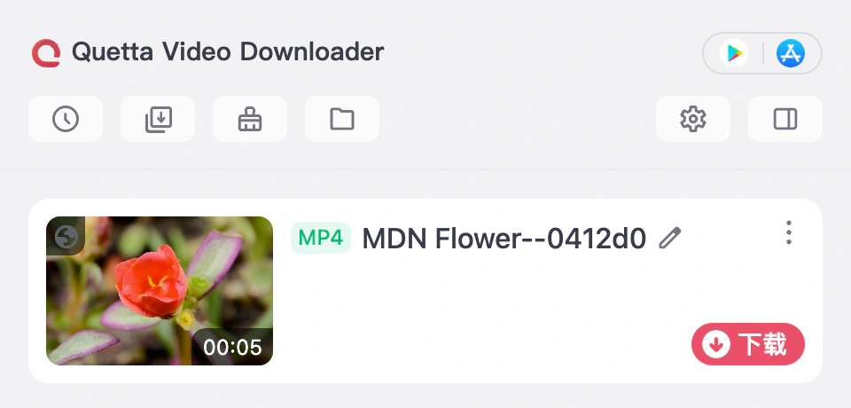
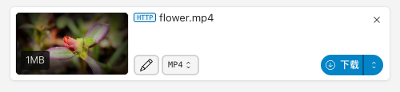
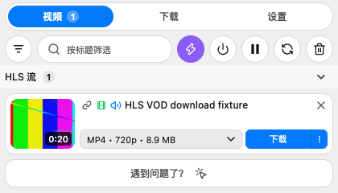
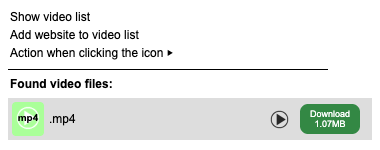
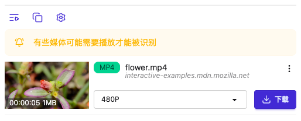
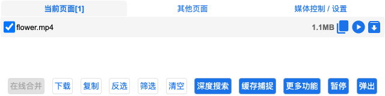

# 6 Chrome video downloader extensions compared (2026)

[简体中文](../README.md) · **English** · [Español](README.es.md) · [Português (Brasil)](README.pt-BR.md) · [日本語](README.ja.md)

This review compares **Quetta Video Downloader, Video Download Helper, MAX Video Downloader, Video Downloader Professional, FetchV, and Cat Catch**. It covers pricing, previews, MP4 and HLS (M3U8) support, and download options on different websites.

Updated **November 24, 2026** · [Tests and reproduction steps](testing.md) · [Sources and image credits](sources.md)

[Quick picks](#quick-picks) · [Six video downloaders](#six-video-downloaders) · [Websites and video formats](#websites-and-video-formats) · [FAQ](#faq)

## Quick picks

- **Preview and choose a quality** → Quetta offers both in its panel and requires no account. FetchV and Cat Catch also offer previews.
- **Work with streams, tracks, or conversions** → FetchV focuses on HLS workflows. MAX provides track and subtitle controls. Video Download Helper also offers conversion and audio extraction.
- **Save direct MP4 files** → Try Quetta or Link64’s Video Downloader Professional. The latter offers a video list for later playback.
- **Inspect the media a page loads** → Cat Catch exposes network resources and includes previews and playlist parsers.

## Six video downloaders

These screenshots show the Chrome extension panels. For verified file saves, see the [test results](testing.md).

### Quetta Video Downloader

Quetta’s Chrome extension is free and requires no account. It detects compatible MP4, WebM, HLS (M3U8), and MPEG-DASH media. Its download panel includes thumbnails, playable previews for compatible media, and quality choices when the source exposes them. Preview is especially useful on a page with multiple clips or renditions. The Chrome listing excludes YouTube, and protected content such as DRM streams falls outside supported use. [Chrome extension](https://chromewebstore.google.com/detail/quetta-video-downloader/cblecgnkfldiipmmfpiolmfhfphhfngo) · [Official guide](https://www.quetta.net/solutions/how-to-download-videos-with-quetta-video-downloader)

*Quetta detected the MDN flower MP4 and played a preview in the download panel.*

**Hands-on check.** The Chrome extension saved a 9.4 MB local MP4 twice. One copy matched the source checksum. HLS file output remains unverified. [Test method and results](testing.md)

### Video Download Helper

The publisher offers builds for Chrome, Firefox, and Edge. The Chrome listing covers HLS and DASH, conversion to MP4, MKV, and WebM, and MP3 extraction. Core features are free, and paid plans add features such as unlimited downloads and subtitles. The Chrome release excludes YouTube downloads. [Official site](https://downloadhelper.net/) · [Chrome extension](https://chromewebstore.google.com/detail/video-download-helper/lmjnegcaeklhafolokijcfjliaokphfk) · [Premium plans](https://downloadhelper.net/premium)

*The panel shows a thumbnail and an MP4 format option for the MDN sample.*

### MAX Video Downloader

MAX is free and requires no account. Its documentation lists HLS, DASH, MP4, and WebM, along with media-based thumbnails, track and subtitle controls, and local muxing. There is an optional desktop companion for heavier tasks. This makes MAX useful when a video has several tracks or languages. The Chrome listing excludes YouTube and DRM-protected media. [Chrome extension](https://chromewebstore.google.com/detail/max-video-downloader-%E2%80%93-do/kjinbaahkmjgkkedfdgpkkelehofieke) · [Official feature details](https://maxvideodownloader.pro/architecture)

*The video list shows the local HLS sample with a thumbnail and a 720p MP4 option.*

### Video Downloader Professional

This review covers the Chrome edition by **Link64 GmbH**. Its free-to-install listing describes saving videos, choosing available resolutions, casting detected MP4 files, and adding videos to a list for later playback. Its documentation provides no clear HLS or DASH support claim. The listing excludes downloads from YouTube, Instagram, Dailymotion, VK, and TikTok. [Chrome extension](https://chromewebstore.google.com/detail/video-downloader-professi/elicpjhcidhpjomhibiffojpinpmmpil)

*The Link64 build lists the MDN MP4 with its file size and a download button.*

### FetchV — M3U8 and HLS video downloader

FetchV is free, requires no account, and provides installation links for Chrome and Edge. Its documentation covers HLS video on demand and live streams, DASH on demand, direct MP4 and WebM, and previews of detected media. It can merge supported HLS segments into MP4. The Chrome listing excludes YouTube and DRM-protected media. [Official site](https://fetchv.net/) · [Chrome extension](https://chromewebstore.google.com/detail/fetchv-video-downloader-f/nfmmmhanepmpifddlkkmihkalkoekpfd)

*The panel shows a thumbnail and a 480p option for the MDN sample.*

### Cat Catch (猫抓)

Cat Catch is a GPL-3.0 browser extension for inspecting media resources. It can show resources the page loaded, preview compatible media, and parse HLS and DASH playlists. The extra controls suit readers who already know the difference between a video URL and a stream manifest. The project documents installation on Chrome, Edge, and Firefox. [Source repository](https://github.com/xifangczy/cat-catch) · [Installation guide](https://cat-catch.94cat.com/docs/install) · [Cat Catch interface screenshots](https://github.com/xifangczy/cat-catch#readme)

*The current-page list shows MDN’s flower.mp4 with copy, preview, and download controls.*

## Websites and video formats

- **MDN · Direct MP4.** Cat Catch for Chrome and Quetta Browser for macOS 2.2.2 saved the public CC0 sample. Quetta Browser is a separate product and has its own entry in the test notes. [MDN sample](https://interactive-examples.mdn.mozilla.net/media/cc0-videos/flower.mp4) · [Download checks](testing.md)
- **Apple Developer · HLS format reference.** Apple’s public playback examples illustrate HLS playlists and adaptive quality. The repeatable download check uses a self-generated, unencrypted HLS video-on-demand fixture. [Apple HLS examples](https://developer.apple.com/streaming/examples/) · [Test fixture](testing.md)
- **Vimeo · Creator-enabled downloads.** Use the Download button on the video page when the creator enables it. Vimeo’s help page describes availability and the options an uploader can offer. [Vimeo Help](https://help.vimeo.com/hc/en-us/articles/12426502581265-How-to-download-a-video-on-Vimeo)
- **YouTube · Official offline viewing.** Several Chrome extensions in this review explicitly exclude YouTube. Eligible viewers can use the offline option described by the platform. [YouTube Help](https://support.google.com/youtube/answer/11977233)

## FAQ

### Which free Chrome video downloader offers previews?

Quetta supports playable previews for compatible media. MAX documents media-based preview thumbnails. FetchV and Cat Catch also offer preview features. Whether a preview loads depends on the media the page serves. [Sources](sources.md)

### Can a Chrome extension convert M3U8 to MP4?

M3U8 is a playlist that often points to multiple media segments. A downloader may need to fetch the segments and combine them. The output depends on the stream, the codecs, and any separate video and audio tracks. Our HLS fixture uses unencrypted H.264 and AAC. [Reproduction steps](testing.md)

### What affects download speed?

Transfer time varies with the source server, connection, file size, and any merging step. The tests verified that particular samples could be saved. Internet transfer rates remain unmeasured. [Test scope](testing.md)
