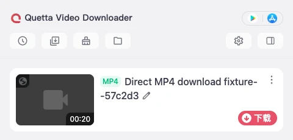
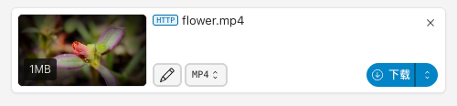
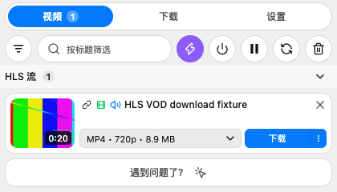
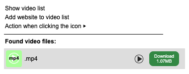
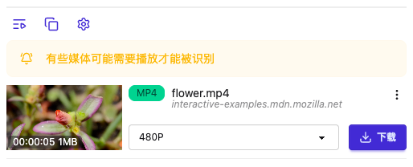
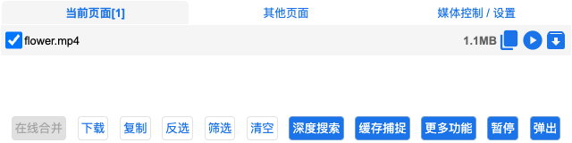

# 6 extensiones para descargar vídeos en Chrome (2026) · MP4, M3U8 y HLS

[简体中文](../README.md) · [English](README.en.md) · **Español** · [Português (Brasil)](README.pt-BR.md) · [日本語](README.ja.md)

**Revisión del 24 de noviembre de 2026.** Comparamos seis extensiones para guardar vídeos que tienes permiso para descargar. Quetta Video Downloader destaca por un flujo sencillo y gratuito con vista previa reproducible en la extensión. MAX permite elegir pistas, FetchV se centra en M3U8 y Cat Catch da acceso a las solicitudes de red de la página. El sitio y el formato determinan qué flujos hay disponibles.

[Qué extensión elegir](#qué-extensión-elegir) · [Las seis extensiones](#las-seis-extensiones) · [Ejemplos por sitio](#ejemplos-por-sitio) · [Preguntas frecuentes](#preguntas-frecuentes)

## Qué extensión elegir

- **Quetta Video Downloader** para reproducir una vista previa, elegir la calidad y guardar el archivo sin crear una cuenta.
- **MAX Video Downloader** para elegir pistas de vídeo, audio y subtítulos por separado, con miniaturas de vista previa.
- **Video Download Helper** para convertir archivos, extraer audio o usar el mismo producto en Chrome, Firefox y Edge.
- **Video Downloader Professional** para vídeos directos y una lista desde la que volver a reproducir lo que has encontrado.
- **FetchV** para guardar un flujo HLS en MP4 desde Chrome o Edge.
- **Cat Catch (猫抓)** para inspeccionar los recursos de la página y trabajar con listas HLS y DASH en una extensión de código abierto.

## Las seis extensiones

Las capturas muestran los paneles de Chrome. Los archivos guardados que se pudieron verificar figuran en los [resultados de las pruebas](testing.md).

### Quetta Video Downloader

La ficha de Chrome de la versión **3.13.0** describe una extensión gratuita y sin registro para descargar HLS (M3U8), DASH (MPD) y archivos como MP4 y WebM. Abre el panel cuando empiece a reproducirse el vídeo, comprueba el clip con la vista previa integrada y elige la calidad que ofrezca la fuente. La versión de Chrome excluye las descargas de YouTube y el contenido con DRM. [Chrome Web Store](https://chromewebstore.google.com/detail/quetta-video-downloader/cblecgnkfldiipmmfpiolmfhfphhfngo)

*Quetta detectó el MP4 local y mostró el área de vista previa y el botón de descarga.*

En dos pruebas, la extensión de Chrome guardó un MP4 de 9,4 MB servido desde el mismo equipo. La segunda copia coincidió con la suma de verificación del original. El panel mostró el área de vista previa. La reproducción en esa área queda pendiente de verificación con este archivo. [Capturas y resultados](testing.md)

### Video Download Helper

Disponible para Chrome, Firefox y Edge. La ficha de Chrome describe compatibilidad con HLS y DASH, conversión a MP4, MKV o WebM y extracción de audio en MP3. Las funciones básicas son gratuitas. Premium ofrece descargas ilimitadas y funciones de subtítulos. Abre el panel para elegir formato y calidad entre las variantes detectadas. La ficha de Chrome excluye las descargas de YouTube. [Ficha y capturas de Chrome Web Store](https://chromewebstore.google.com/detail/video-download-helper/lmjnegcaeklhafolokijcfjliaokphfk) · [Planes del desarrollador](https://downloadhelper.net/premium)

*El panel muestra una miniatura y una opción de formato MP4 para el vídeo de MDN.*

### MAX Video Downloader

Extensión gratuita de Chrome para HLS, DASH, MP4 y WebM que muestra miniaturas de los vídeos detectados. Puedes elegir pistas y subtítulos y combinarlos en el dispositivo. El complemento de escritorio es opcional y se orienta a tareas más exigentes. Su ficha excluye YouTube y los vídeos protegidos por DRM. [Ficha y capturas de Chrome Web Store](https://chromewebstore.google.com/detail/max-video-downloader-%E2%80%93-do/kjinbaahkmjgkkedfdgpkkelehofieke) · [Funciones y miniaturas](https://maxvideodownloader.pro/) · [Procesamiento local](https://maxvideodownloader.pro/architecture)

*La lista de vídeos muestra el flujo HLS local con una miniatura y una opción de MP4 a 720p.*

### Video Downloader Professional

La edición de Link64 GmbH se instala gratis en Chrome. Su ficha describe la selección de resoluciones según el sitio, el envío de MP4 a Chromecast y una lista para volver a reproducir los vídeos. La compatibilidad con HLS y DASH queda sin confirmar en esa ficha, que también indica restricciones para descargar de YouTube, Instagram, Dailymotion, VK y TikTok. [Ficha y capturas de Chrome Web Store](https://chromewebstore.google.com/detail/video-downloader-professi/elicpjhcidhpjomhibiffojpinpmmpil)

*La versión de Link64 muestra el MP4 de MDN con el tamaño del archivo y el botón de descarga.*

### FetchV · Descargador de M3U8 y HLS

Extensión gratuita de Chrome y Edge que detecta HLS, incluidas emisiones en directo, DASH bajo demanda y archivos MP4 o WebM. Ofrece vista previa y puede guardar un flujo HLS como MP4. Reproduce el vídeo de la página para que la extensión detecte el flujo. La documentación excluye YouTube y el contenido protegido por DRM. [Página de FetchV](https://fetchv.net/) · [Capturas de Chrome Web Store](https://chromewebstore.google.com/detail/fetchv-video-downloader-f/nfmmmhanepmpifddlkkmihkalkoekpfd)

*El panel muestra una miniatura y una opción de 480p para el vídeo de MDN.*

### Cat Catch (猫抓)

Herramienta gratuita y de código abierto con licencia GPL-3.0. Inspecciona las solicitudes de red de la página para localizar archivos de vídeo y listas HLS o DASH. Ofrece vista previa y analizadores de listas. Si aparecen varios recursos, revisa el tipo, el tamaño y la vista previa para identificar la pista que buscas. Esta flexibilidad implica más controles en el panel. [Proyecto Cat Catch en GitHub](https://github.com/xifangczy/cat-catch) · [Captura oficial del panel](https://github.com/xifangczy/cat-catch/blob/master/README/popup.png)

*La lista de la página actual muestra flower.mp4 de MDN con opciones para copiar, previsualizar y descargar.*

## Ejemplos por sitio

- **MDN y un MP4 directo.** El vídeo de la flor, publicado bajo CC0, sirve para comprobar si la extensión detecta un archivo directo y si el archivo guardado se reproduce. [Ejemplo de MDN](https://developer.mozilla.org/en-US/docs/Web/HTML/Reference/Elements/video)
- **Muestras HLS de Apple.** Las páginas para desarrolladores ilustran listas M3U8 y variantes de calidad. Son una referencia para entender cómo se reproduce HLS. Para una prueba reproducible de descarga, consulta el flujo local descrito en el registro. [Ejemplos de Apple](https://developer.apple.com/streaming/examples/) · [Metodología](testing.md)
- **Vimeo.** Usa el botón de descarga del propio vídeo cuando su propietario lo haya habilitado. Las variantes disponibles dependen del vídeo y de su configuración. [Ayuda de Vimeo](https://help.vimeo.com/hc/en-us/articles/12426502581265-How-to-download-a-video-on-Vimeo)
- **YouTube.** Para tus propias subidas puedes utilizar YouTube Studio. Para ver vídeos sin conexión, consulta la opción oficial de YouTube Premium en los dispositivos y regiones admitidos. Varias fichas de las extensiones de Chrome comparadas excluyen expresamente las descargas de YouTube. [Descargar tus propios vídeos](https://support.google.com/youtube/answer/56100) · [Visualización sin conexión](https://support.google.com/youtube/answer/11977233)

## Preguntas frecuentes

**¿Qué extensión gratuita permite reproducir el vídeo antes de descargarlo?** Quetta Video Downloader ofrece una vista previa reproducible en el panel. FetchV y Cat Catch también documentan vistas previas. MAX muestra miniaturas de los recursos detectados. [Fuentes de las extensiones](sources.md)

**¿Qué diferencia hay entre un archivo MP4 y una lista M3U8?** Un MP4 directo es un archivo multimedia. Una lista M3U8 describe las variantes o los segmentos de un flujo HLS. Para guardarlo como un único MP4, la extensión debe obtener los segmentos de la variante elegida y reunirlos. [Muestras de HLS](https://developer.apple.com/streaming/examples/)

**¿Qué descargador de vídeos es más rápido?** El tiempo depende del servidor, de la red, del número de segmentos y de la unión de pistas. Una comparación de velocidad sirve cuando se usa el mismo medio, la misma calidad y mediciones repetidas. [Pruebas y metodología](testing.md)
