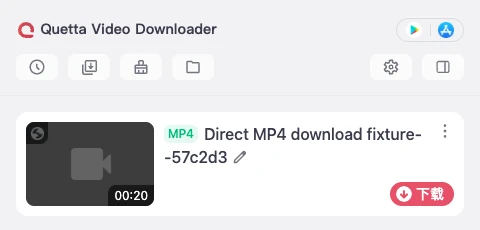

# 動画ダウンロード拡張機能6選【2026年】｜ChromeでMP4・HLS（M3U8）を保存

[简体中文](../README.md) · [English](README.en.md) · [Español](README.es.md) · [Português (Brasil)](README.pt-BR.md) · **日本語**

更新日 2026年11月24日 · [検証方法と結果](testing.md) · [出典と画像クレジット](sources.md)

Chrome、Edge、Firefox向けの動画ダウンロード拡張機能を、対応形式、プレビュー、料金、操作手順で比較しました。MP4やWebMの直接配信と、HLS（M3U8）やMPEG-DASHの分割配信では、保存に必要な機能が異なります。ダウンロードするのは、自分が作成した動画や、権利者が保存を許可している動画に限ってください。

## 用途別の選び方

- **保存する前に動画を確認したい**場合は、パネルで対応する動画のプレビューを表示できる **Quetta Video Downloader** が候補です。基本機能は無料で、アカウント登録は不要です。FetchVとCat Catchにもプレビュー機能があります。
- **HLSやDASHの動画を保存したい**場合は **Quetta**、**MAX Video Downloader**、**FetchV**。ファイル形式の変換も重視する場合は **Video DownloadHelper** が候補です。
- **シンプルなMP4を保存したい**場合は **Video Downloader Professional**。**ページが読み込む動画のURLや配信形式を調べたい**場合は、オープンソースの **Cat Catch（猫抓）** が向いています。

## 6つの動画ダウンローダー

### 1. Quetta Video Downloader

対応ブラウザーはChrome、Edge、Firefox。基本的なダウンロード機能は無料で、アカウント登録も不要です。Chrome公式ストアにはMP4、WebM、HLS（M3U8）、MPEG-DASH、対応するライブ配信の保存が記載されています。配信元が複数の画質を提供していれば、ダウンロード前に選択できます。

動画を再生してツールバーのアイコンを開くと、検出した候補を確認できます。対応する候補にはサムネイルやパネル内の動画プレビューが用意されています。動画上のボタンや右クリックから操作できるページもあります。Chrome版はYouTubeのダウンロードに非対応で、DRMで保護された動画も対象外です。［[Chrome Web Store](https://chromewebstore.google.com/detail/quetta-video-downloader/cblecgnkfldiipmmfpiolmfhfphhfngo)・[公式ガイド](https://www.quetta.net/solutions/how-to-download-videos-with-quetta-video-downloader)・[Firefox Add-ons](https://addons.mozilla.org/en-US/firefox/addon/quetta-video-downloader/)］

Chrome拡張機能3.13.0で、同じ端末から配信した約9.4 MBのMP4を2回保存できました。2回目の保存ファイルのSHA-256は元ファイルと一致しました。プレビュー欄は表示されましたが、今回のサンプルではパネル内の再生まで確認できませんでした。［[検証画面と記録](testing.md)］

### 2. Video DownloadHelper

Chrome、Edge、Firefox向けの拡張機能で、HLSやMPEG-DASHに対応しています。動画をMP4、MKV、WebMに変換したり、音声をMP3として取り出したりしたい場合に候補になります。基本機能は無料で、ダウンロード回数の制限解除や字幕などを含む有料プランもあります。使える機能はブラウザーとプランで確認できます。［[Chrome Web Store](https://chromewebstore.google.com/detail/video-download-helper/lmjnegcaeklhafolokijcfjliaokphfk)・[公式プラン案内](https://downloadhelper.net/premium)］

### 3. MAX Video Downloader

Chrome向けの無料拡張機能です。公式ストアにはHLS、MPEG-DASH、MP4、WebM、対応するライブ配信に加え、音声や字幕の抽出も記載されています。検出一覧にはプレビュー用のサムネイルがあり、複数の候補が表示されたときに見分けやすくなります。音声や字幕を取り出せるかどうかは、配信元が提供するトラックに左右されます。［[Chrome Web Store](https://chromewebstore.google.com/detail/max-video-downloader-%E2%80%93-do/kjinbaahkmjgkkedfdgpkkelehofieke)・[MAX公式サイト](https://maxvideodownloader.pro/)］

### 4. Video Downloader Professional

ここではChrome Web StoreでLink64が公開している製品を扱います。無料でインストールでき、ページで検出した動画を候補一覧から選ぶ基本操作は、直接配信のMP4を保存するときに使いやすい構成です。HLSやMPEG-DASHの対応は公式掲載情報から確認できていません。［[Chrome Web Store](https://chromewebstore.google.com/detail/video-downloader-professi/elicpjhcidhpjomhibiffojpinpmmpil)］

### 5. FetchV（M3U8・HLS動画ダウンローダー）

ChromeとEdge向けに提供される無料の拡張機能で、登録は不要です。HLS（M3U8）、オンデマンドのMPEG-DASH、MP4やWebMの直接配信に対応しています。検出したリソースの確認やプレビューができ、互換性のある分割動画をまとめて保存したいときに便利です。Chrome版ではYouTubeとDRMで保護された動画は対象外です。［[FetchV公式サイト](https://fetchv.net/)・[Chrome Web Store](https://chromewebstore.google.com/detail/fetchv-video-downloader-f/nfmmmhanepmpifddlkkmihkalkoekpfd)］

### 6. Cat Catch（猫抓）

Chrome、Edge、Firefoxでブラウザーが読み込むメディアを一覧表示するオープンソースの拡張機能です。GPL-3.0で公開されており、対応する動画のプレビューのほか、HLS（M3U8）やMPEG-DASHの解析機能もあります。動画、音声、プレイリストのどれを選ぶべきか確認しながら使いたい人に向いています。［[Cat Catch公式GitHubリポジトリ](https://github.com/xifangczy/cat-catch)・[公式インストールガイド](https://cat-catch.94cat.com/docs/install)］

[プロジェクトの画面を見る](https://raw.githubusercontent.com/xifangczy/cat-catch/master/README/popup.png)

## サイトによってダウンロード方法はどう変わるか

- **MDNの動画サンプル**。CC0の花の短いMP4は、直接配信の動画を試すのに適しています。macOS版の **Quetta Browser 2.2.2** で直接リンクから約1.1 MBの動画を保存し、H.264映像とAAC音声が含まれることを確認しました。Quetta Browserは独立したブラウザー製品です。［[MDNの再生ページ](https://interactive-examples.mdn.mozilla.net/pages/tabbed/video.html)・[CC0のMP4サンプル](https://interactive-examples.mdn.mozilla.net/media/cc0-videos/flower.mp4)・[検証記録](testing.md)］
- **AppleのHLS資料**。HLS配信では、M3U8プレイリストを手がかりに複数のセグメントを取得します。保存には、配信形式とセグメントの処理に対応する拡張機能が必要です。［[AppleのHLS配信サンプル](https://developer.apple.com/streaming/examples/)］
- **Vimeo**。投稿者がダウンロードを許可している場合、Vimeo上に公式のダウンロード操作が表示されます。［[Vimeo公式ヘルプ](https://help.vimeo.com/hc/en-us/articles/12426502581265-How-to-download-a-video-on-Vimeo)］
- **YouTube**。オフライン視聴には、アカウントや地域の条件を満たす場合にYouTube公式のダウンロード機能を利用できます。Quetta Video DownloaderのChrome版にはYouTubeのダウンロード機能がありません。［[YouTube公式ヘルプ](https://support.google.com/youtube/answer/11977233?hl=ja)・[Chrome Web Store](https://chromewebstore.google.com/detail/quetta-video-downloader/cblecgnkfldiipmmfpiolmfhfphhfngo)］

## よくある質問

### MP4とM3U8の違いは何ですか？

MP4は動画や音声を収めるコンテナ形式です。M3U8はHLSで使うプレイリストの形式で、配信セグメントや利用できる画質を示します。HLSをオフラインで再生できるファイルとして保存するには、セグメントを取得し、対応する形式にまとめる処理が必要です。［[Apple HTTP Live Streaming](https://developer.apple.com/streaming/)］

### Quetta Video Downloaderは無料でプレビューできますか？

基本機能は無料で、登録も不要です。公開されている拡張機能にはパネル内の動画プレビューがあり、読み込めるかどうかは配信元や動画形式によって変わります。今回のローカルサンプルでは、プレビュー欄が表示されるところまで確認しました。［[機能の出典](sources.md)・[検証記録](testing.md)］

### 動画ダウンロードの速さは何で決まりますか？

所要時間は、動画のサイズや画質、回線と配信サーバー、拡張機能が行う結合などの処理で変わります。ツールごとの所要時間を比べるには、同じ動画と画質を使い、同じ条件で複数回測定します。［[検証方法](testing.md)］
