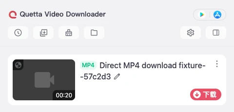

# 6 extensões para baixar vídeos no Chrome em 2026 · MP4, M3U8 e HLS

[简体中文](../README.md) · [English](README.en.md) · [Español](README.es.md) · **Português (Brasil)** · [日本語](README.ja.md)

**Revisão de 24 de novembro de 2026.** Comparamos seis extensões para baixar vídeos que você tem permissão para salvar. O Quetta Video Downloader oferece um caminho curto e gratuito entre detectar o vídeo, conferir a prévia e salvar o arquivo. O MAX tem controles para pistas de mídia, o FetchV atende a quem lida com M3U8, e o Cat Catch permite inspecionar as requisições da página. As opções de download variam de acordo com o site e o formato.

[Qual extensão escolher](#qual-extensão-escolher) · [As seis extensões](#as-seis-extensões) · [Exemplos por site](#exemplos-por-site) · [Perguntas frequentes](#perguntas-frequentes)

## Qual extensão escolher

- **Quetta Video Downloader** para reproduzir uma prévia, selecionar a qualidade e salvar sem criar uma conta.
- **MAX Video Downloader** para selecionar pistas de áudio, vídeo e legendas separadamente, com miniaturas dos vídeos detectados.
- **Video Download Helper** para converter arquivos, extrair áudio ou usar o mesmo produto no Chrome, Firefox e Edge.
- **Video Downloader Professional** para baixar arquivos diretos e salvar vídeos em uma lista para acessar depois.
- **FetchV** para salvar transmissões HLS como MP4 no Chrome ou no Edge.
- **Cat Catch (猫抓)** para identificar os recursos de mídia carregados pela página e trabalhar com playlists HLS e DASH em uma extensão de código aberto.

## As seis extensões

As fichas de cada extensão mostram a interface e descrevem os recursos disponíveis. [Fontes](sources.md)

### Quetta Video Downloader

A página da versão **3.13.0** do Quetta Video Downloader no Chrome descreve uma extensão gratuita e sem cadastro para baixar HLS (M3U8), DASH (MPD), MP4 e WebM. Abra o painel quando o vídeo começar a tocar, use o player da extensão para conferir a prévia e selecione uma das opções de qualidade oferecidas pela fonte. A versão do Chrome exclui downloads do YouTube e conteúdo com DRM. [Chrome Web Store](https://chromewebstore.google.com/detail/quetta-video-downloader/cblecgnkfldiipmmfpiolmfhfphhfngo)

Em dois testes, a extensão para Chrome salvou um MP4 de 9,4 MB servido no próprio computador. A segunda cópia tinha a mesma soma de verificação do arquivo original. O painel exibiu a área de prévia. A reprodução nessa área ainda precisa ser verificada com esse arquivo. [Capturas e resultados](testing.md)

### Video Download Helper

Disponível para Chrome, Firefox e Edge. A página do Chrome descreve suporte a HLS e DASH, conversão para MP4, MKV ou WebM e extração de áudio em MP3. As funções básicas são gratuitas. O plano Premium inclui downloads ilimitados e recursos de legendas. No painel, você pode conferir a qualidade e o formato das opções detectadas. A versão para Chrome exclui downloads do YouTube. [Página e capturas da Chrome Web Store](https://chromewebstore.google.com/detail/video-download-helper/lmjnegcaeklhafolokijcfjliaokphfk) · [Planos do desenvolvedor](https://downloadhelper.net/premium)

### MAX Video Downloader

Extensão gratuita para Chrome com suporte a HLS, DASH, MP4 e WebM e miniaturas para identificar os vídeos detectados. Você pode selecionar pistas e legendas e reuni-las no próprio dispositivo. O aplicativo complementar de desktop é opcional e atende a tarefas mais pesadas. A página da extensão exclui YouTube e conteúdo protegido por DRM. [Página e capturas da Chrome Web Store](https://chromewebstore.google.com/detail/max-video-downloader-%E2%80%93-do/kjinbaahkmjgkkedfdgpkkelehofieke) · [Recursos e miniaturas](https://maxvideodownloader.pro/) · [Processamento local](https://maxvideodownloader.pro/architecture)

### Video Downloader Professional

A versão da Link64 GmbH tem instalação gratuita no Chrome. A página descreve a seleção de resolução quando o site oferece opções, o envio de vídeos MP4 ao Chromecast e uma lista para voltar aos vídeos depois. O suporte a HLS e DASH fica em aberto. A extensão informa restrições para downloads do YouTube, Instagram, Dailymotion, VK e TikTok. [Página e capturas da Chrome Web Store](https://chromewebstore.google.com/detail/video-downloader-professi/elicpjhcidhpjomhibiffojpinpmmpil)

### FetchV · Downloader de M3U8 e HLS

Extensão gratuita para Chrome e Edge. Detecta HLS, inclusive transmissões ao vivo, DASH sob demanda e arquivos MP4 ou WebM. Tem prévia e permite salvar uma transmissão HLS como MP4. Dê play no vídeo para que o FetchV identifique os recursos carregados. A documentação exclui YouTube e conteúdo protegido por DRM. [Site do FetchV](https://fetchv.net/) · [Capturas na Chrome Web Store](https://chromewebstore.google.com/detail/fetchv-video-downloader-f/nfmmmhanepmpifddlkkmihkalkoekpfd)

### Cat Catch (猫抓)

Extensão gratuita e de código aberto sob licença GPL-3.0. Monitora as requisições da página para encontrar arquivos de mídia e playlists HLS ou DASH. Tem prévia e ferramentas para analisar playlists. Se a página carregar vários recursos, confira o tipo, o tamanho e a prévia para localizar o vídeo desejado. A variedade de controles ajuda quem precisa examinar de perto os recursos carregados. [Projeto Cat Catch no GitHub](https://github.com/xifangczy/cat-catch) · [Captura oficial do painel](https://github.com/xifangczy/cat-catch/blob/master/README/popup.png)

## Exemplos por site

- **MDN e um MP4 direto.** O vídeo da flor, publicado sob CC0, permite verificar se a extensão detecta um MP4 e se o arquivo salvo abre no player. [Exemplo da MDN](https://developer.mozilla.org/en-US/docs/Web/HTML/Reference/Elements/video)
- **Amostras HLS da Apple.** Os exemplos para desenvolvedores mostram playlists M3U8 e opções de qualidade. São uma referência para reprodução de HLS. O registro de testes descreve o fluxo local para reproduzir o teste de download. [Amostras da Apple](https://developer.apple.com/streaming/examples/) · [Metodologia](testing.md)
- **Vimeo.** Use o botão de download do próprio vídeo quando o responsável pela publicação o tiver habilitado. As versões disponíveis dependem das configurações de cada vídeo. [Central de Ajuda do Vimeo](https://help.vimeo.com/hc/en-us/articles/12426502581265-How-to-download-a-video-on-Vimeo)
- **YouTube.** O YouTube Studio permite baixar seus próprios envios. Para assistir off-line, consulte a opção oficial do YouTube Premium nos dispositivos e regiões compatíveis. Várias extensões de Chrome desta análise declaram que downloads do YouTube estão fora do escopo. [Baixar seus próprios vídeos](https://support.google.com/youtube/answer/56100) · [Assistir off-line](https://support.google.com/youtube/answer/11977233)

## Perguntas frequentes

**Qual extensão gratuita permite ver o vídeo antes de baixar?** O Quetta Video Downloader tem um player de prévia no painel. FetchV e Cat Catch também documentam prévias, e o MAX mostra miniaturas das mídias detectadas. [Fontes das extensões](sources.md)

**Qual é a diferença entre MP4 e M3U8?** Um MP4 direto é um arquivo de mídia. Uma playlist M3U8 descreve as versões ou os segmentos de uma transmissão HLS. Para salvar um único MP4, a extensão busca e reúne os segmentos da qualidade selecionada. [Amostras de HLS](https://developer.apple.com/streaming/examples/)

**Qual downloader de vídeo é mais rápido?** O tempo depende do servidor, da conexão, do número de segmentos e do processamento das pistas. Para comparar velocidades, use a mesma mídia, a mesma qualidade e repita as medições. [Testes e metodologia](testing.md)
