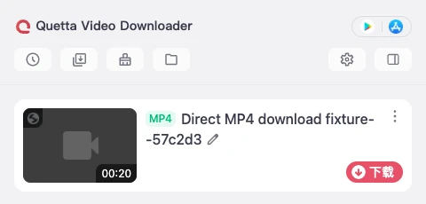
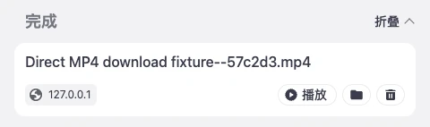

# Video downloader tests and reproduction steps

## Results · 2026-11-24

Tests used macOS 15.5 (Apple Silicon). The Chrome checks used Chrome for Testing 157.0.8103.38 and a clean profile per extension, loading the Chrome Web Store packages as unpacked extensions. The checks exercised the extensions’ panels. The inputs were MDN’s direct CC0 flower MP4 and the local MP4 and unencrypted HLS fixtures described below.

- **Quetta Video Downloader 3.13.0.** Saved the 9,437,854-byte local MP4 in two runs. The file from the second run matched the source SHA-256 and contained 20 seconds of 1280 × 720 H.264 video with AAC audio. The preview area appeared, and playback in that preview was unverified on this local fixture. Quetta listed the HLS sample on one pass. Subsequent passes stayed on the searching screen, so HLS file output remains unverified.
- **MAX Video Downloader 2.51.1 and FetchV 4.0.4.** Both displayed the MDN MP4 and the local HLS fixture on at least one pass. Successful file output remains unverified in these checks.
- **Video Downloader Professional 2.1.7.** Link64’s panel listed the MDN MP4. The local HLS sample yielded no candidate in the observed pass. Successful file output remains unverified.
- **Cat Catch 2.7.4.** Detected and saved the MDN MP4. The 1,128,375-byte file contained H.264 and AAC and had a duration of 5.055 seconds. The observed local HLS pass did not show a candidate.
- **Video Download Helper 10.7.1.2.** The clean profile displayed an initial terms prompt. Detection and saving were unverified.
- **Quetta Browser for macOS 2.2.2.** The separate browser product saved the direct MDN MP4. The output matched the Cat Catch file’s SHA-256. [MDN MP4 sample](https://interactive-examples.mdn.mozilla.net/media/cc0-videos/flower.mp4)

The tests cover two MP4 samples and one local HLS sample. Internet throughput remains unmeasured. Apple, Vimeo, and YouTube are documentation-based scenarios.





## Reproducible fixtures

The local fixtures contain a 20-second FFmpeg test pattern and a 440 Hz tone. One page plays the original H.264/AAC MP4. The other uses the same encoded media in an unencrypted HLS video-on-demand playlist with ten two-second MPEG-TS segments.

## Serve the fixtures locally

Run this in Bash or zsh with FFmpeg (including libx264), Python 3 and curl installed. The pinned HLS player is fetched once during setup. Both test pages serve media from your own machine on port 8768.

```sh
fixture_dir="$(mktemp -d)"
cd "$fixture_dir" || exit 1

ffmpeg -hide_banner -loglevel error \
  -f lavfi -i 'testsrc2=size=1280x720:rate=30' \
  -f lavfi -i 'sine=frequency=440:sample_rate=48000' \
  -t 20 -c:v libx264 -pix_fmt yuv420p -preset veryfast -crf 20 \
  -g 60 -sc_threshold 0 -c:a aac -b:a 128k -movflags +faststart sample.mp4

ffmpeg -hide_banner -loglevel error -i sample.mp4 -c copy \
  -f hls -hls_time 2 -hls_playlist_type vod -hls_flags independent_segments \
  -hls_segment_filename 'segment-%03d.ts' sample.m3u8

curl --fail --silent --show-error --location \
  'https://cdn.jsdelivr.net/npm/hls.js@1.6.15/dist/hls.min.js' -o hls.min.js

cat > mp4.html <<'HTML'
<!doctype html>
<html lang="en">
<meta charset="utf-8">
<title>Direct MP4 download fixture</title>
<h1>Direct MP4 download fixture</h1>
<video controls preload="metadata" width="720" src="sample.mp4"></video>
</html>
HTML

cat > hls.html <<'HTML'
<!doctype html>
<html lang="en">
<meta charset="utf-8">
<title>HLS VOD download fixture</title>
<h1>HLS VOD download fixture</h1>
<video id="player" controls width="720"></video>
<script src="./hls.min.js"></script>
<script>
const player = document.getElementById("player");
const playlist = "./sample.m3u8";
if (window.Hls && Hls.isSupported()) {
  const hls = new Hls();
  hls.loadSource(playlist);
  hls.attachMedia(player);
} else {
  player.src = playlist;
}
</script>
</html>
HTML

python3 -m http.server 8768 --bind 127.0.0.1
```

- Direct MP4 player at `http://127.0.0.1:8768/mp4.html`
- Unencrypted HLS player at `http://127.0.0.1:8768/hls.html`

Stop the server with Ctrl+C after the checks.

## Check detection, preview and save

1. Record the operating system, browser version and downloader version. Use a clean browser profile with competing download extensions disabled.
2. Open a fixture page, start playback and open the downloader. Check whether the downloaded format is identifiable and whether the candidate can be previewed before saving.
3. Save the video. Record whether a companion app, account, or payment prompt appears and whether the saved file plays with video and audio.
4. If timing downloads, start at the actual download action and stop after the final file is saved. Use matching format and resolution, equal cache conditions, and at least three attempts per tool. Record individual results and compare medians for the same fixture. Loopback timings describe local processing and disk writes. An internet speed comparison needs its own controlled source and test conditions.

Use this command with the saved file path to inspect its format, streams, duration and size.

```sh
ffprobe -v error -show_entries \
  format=duration,size:stream=codec_type,codec_name,width,height \
  -of json '/path/to/saved-file.mp4'
```

## Website references

- MDN documents direct playback using the HTML `<video>` element. This is the mechanism used by the direct MP4 fixture. [MDN HTML video reference](https://developer.mozilla.org/en-US/docs/Web/HTML/Reference/Elements/video)
- Apple publishes example HLS streams for playback testing. Individual streams can differ in codecs, rendition layout and device compatibility. The generated playlist above gives every tool the same H.264/AAC input. [Apple HLS streaming examples](https://developer.apple.com/streaming/examples/)
- Vimeo provides a Download button on a video page when the owner enables downloads. The built-in download flow is the reference for that site. [Vimeo Help Center](https://help.vimeo.com/hc/en-us/articles/12426502581265-How-to-download-a-video-on-Vimeo)
